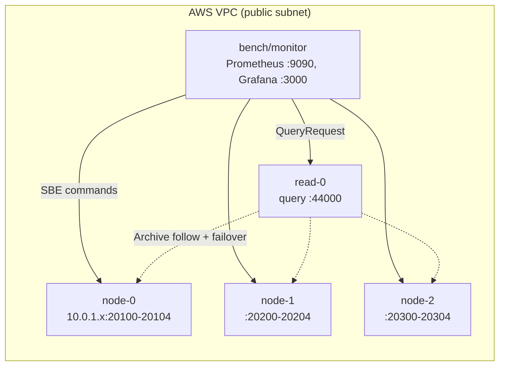

# AWS Deployment (Terraform + Ansible)

Deploys the LEDGERD full topology to AWS EC2 and provides a load/bench harness
with Prometheus + Grafana. This is a single-AZ POC setup; see
[Production notes](#production-notes) for what changes before production use.

## What this deploys

- 3 EC2 instances running the Raft write cluster (`ledgerd-node-0/1/2`).
- 1 EC2 instance running the read replica (`ledgerd-read-0`).
- 1 EC2 instance acting as the bench driver and the monitoring host
  (Prometheus + Grafana). Set `split_bench_monitor = true` to separate them.

Each instance runs the JVM directly (no Docker), so Aeron uses the instances'
real private IPs over UDP with no overlay networking.



## Prerequisites

- AWS credentials in the environment (`AWS_ACCESS_KEY_ID` / `AWS_SECRET_ACCESS_KEY`)
  or the shared config file.
- Terraform 1.3+ and Ansible 2.15+ on the control machine.
- Ansible collections `ansible.posix` and `community.general`
  (`ansible-galaxy collection install ansible.posix community.general`).
- JDK 21 locally to build the distribution.

## Directory layout

```
deploy/aws/
  terraform/                 VPC, SG, EC2, EBS, keypair, inventory generation
  ansible/
    ansible.cfg
    inventory/
      group_vars/all.yml     shared variables
      hosts.yml              auto-generated by Terraform (gitignored)
    roles/
      jdk/                   Temurin JDK 21
      common/                user, dirs, distribution
      ledgerd-node/          cluster node systemd unit + properties
      ledgerd-read/          read replica systemd unit
      prometheus/            scrape config for node /metrics
      grafana/               datasource + LEDGERD dashboard
      bench/                 bench.env + ledgerd-bench script
    playbooks/
      deploy.yml
      bench.yml
  bench/
    run-bench.sh             load/bench driver (copied to the bench host)
  README.md
```

## 1. Build the distribution

One `examples` distribution bundles every role (node, read replica, load driver,
read check). Build it on the control machine:

```bash
cd <repo-root>
./gradlew :examples:distTar
```

This produces `examples/build/distributions/examples.tar`, which Ansible copies
to each instance and extracts to `/opt/ledgerd/examples/lib/`.

## 2. Provision infrastructure (Terraform)

```bash
cd deploy/aws/terraform
terraform init
terraform plan
terraform apply
```

Terraform creates the VPC, subnet, security group (self-referencing so Aeron UDP
flows between all members), instances, per-node EBS data volumes, an SSH key
pair, and writes `ansible/inventory/hosts.yml` from the instance private IPs.

Useful outputs after apply: `node_private_ips`, `read_private_ip`, `grafana_url`,
`cluster_members`.

## 3. Deploy the cluster (Ansible)

```bash
cd deploy/aws/ansible
ansible-playbook -i inventory/hosts.yml playbooks/deploy.yml
```

The playbook installs JDK 21, copies and extracts the distribution, mounts the
EBS data volume on each node, installs systemd units, and starts the cluster.
Node metrics are exposed on `9100 + node_id`.

Verify health:

```bash
curl http://<node-0-public-ip>:9100/healthz   # "ok"
curl http://<node-0-public-ip>:9100/metrics
```

## 4. Run the load/bench

The bench host has `/usr/local/bin/ledgerd-bench`, which runs N concurrent
`LoadGenerator` processes, aggregates p50/p99/p99.9/max latency into a CSV under
`/var/lib/ledgerd/bench/results.csv`, and verifies the read replica converges.

```bash
cd deploy/aws/ansible

# Default: 100000 commands/client x 4 concurrent clients.
ansible-playbook -i inventory/hosts.yml playbooks/bench.yml

# Sweep the in-flight window, 8 concurrent clients, 200k commands each.
ansible-playbook -i inventory/hosts.yml playbooks/bench.yml \
  -e ledgerd_total=200000 -e ledgerd_concurrency=8 \
  -e sweep_in_flight=128,512,1024,4096
```

Alternatively, SSH into the bench host and drive it directly:

```bash
ssh -i ../.ssh/ledgerd-key.pem ubuntu@<bench-ip>
sudo LEDGERD_TOTAL=100000 LEDGERD_CONCURRENCY=4 /usr/local/bin/ledgerd-bench
```

### Batch load (high throughput)

`/usr/local/bin/ledgerd-batch` drives `BatchLoadGenerator` processes submitting
transfer batches (ADR 0012). Throughput is measured in legs/s, one to three
orders of magnitude higher than single commands because each batch amortizes the
consensus append.

```bash
ssh -i ../.ssh/ledgerd-key.pem ubuntu@<bench-ip>
sudo LEDGERD_TOTAL=1000000 LEDGERD_CONCURRENCY=4 \
  SWEEP_LEGS_PER_BATCH=256,1024,2048,4096 SKIP_READCHECK=1 \
  /usr/local/bin/ledgerd-batch
```

`SKIP_READCHECK=1` skips the read-replica convergence check, useful for pure
throughput sweeps (the read replica can lag behind bursty batch load).

### Grafana

Open `http://<monitor-ip>:3000` (admin/admin). Three dashboards are provisioned:

- `LEDGERD Overview` - node-side command throughput, cumulative commands,
  balance count, and leader elections (scraped from each node's `/metrics`).
- `LEDGERD Client Bench` - single-command in-flight sweep (p50/p99/p99.9 per
  `max_in_flight`) and client-side backpressure.
- `LEDGERD Client Batch Bench` - transfer-batch sweep (legs/s, batches/s,
  p50/p99 per `legs_per_batch`).

The client dashboards are served by the bench results exporter on `:9200`, which
reads `/var/lib/ledgerd/bench/results.csv` (single-command) and
`batch-results.csv` (batch). Prometheus scrapes every 5s.

## 5. Optional: fault injection

Adapt the containerized harness to EC2 to verify exactly-once across a leader
kill: SSH into the bench host, start a long `ledgerd-bench` run in the
background, then stop the current leader's systemd unit:

```bash
ssh -i ../.ssh/ledgerd-key.pem ubuntu@<node-ip> sudo systemctl stop ledgerd-node
```

The remaining 2-node quorum elects a new leader; the in-flight client observes
`leaderChanges>=1` and the run must still complete with `nonSuccess=0`.

## 6. Reset state between bench runs

The bench harness assumes the cluster supply only grows across runs and caches
the running expectation in `/var/lib/ledgerd/bench/supply_state` (plus a
client-id cursor in `client_id_state`). To start a fresh bench run from supply 0,
wipe the cluster, the read replica driver, and the bench state together:

```bash
cd deploy/aws/ansible

# Stop services, wipe state, restart, and wait for each node's /healthz.
ansible-playbook -i inventory/hosts.yml playbooks/reset.yml

# Wipe only, leave services stopped (re-run deploy.yml to bring them back).
ansible-playbook -i inventory/hosts.yml playbooks/reset.yml -e reset_restart=false
```

Clearing `/var/lib/ledgerd/bench` removes `results.csv`, `batch-results.csv`,
the client logs, and the `supply_state` / `client_id_state` cursors. The
`reset.yml` playbook wipes all of these together because a reset cluster with a
stale `supply_state` would make the next `ReadCheck` expect the old cumulative
supply and time out.

## 7. Cleanup

```bash
cd deploy/aws/terraform
terraform destroy
```

The generated SSH key (`deploy/aws/.ssh/`) and inventory are gitignored.

## Performance tuning

The cluster nodes and read replica expose three JVM-level knobs, applied by the
deploy playbook via the systemd units: media driver threading mode, UDP socket
buffers, and GC.

### UDP socket buffers

Aeron transfers term buffers over UDP. If the socket receive buffer is smaller
than the burst of in-flight fragments, the kernel drops packets and Aeron must
recover via NAK, which surfaces as latency spikes. The deploy defaults to 16 MB
for `SO_RCVBUF`/`SO_SNDBUF` and bumps `net.core.rmem_max`/`wmem_max` to 32 MB.
The kernel doubles a requested socket buffer for bookkeeping, so the OS max
must be at least 2x the socket buffer.

- `ledgerd_socket_buf_length` -> `-Dledgerd.socketSndbufLength` and
  `-Dledgerd.socketRcvbufLength`.
- `ledgerd_os_socket_max` -> `net.core.rmem_max` / `net.core.wmem_max` sysctl.

### Media driver threading mode

| Mode | Threads | Tradeoff |
|------|---------|----------|
| `SHARED` | 1 (conductor + receiver + sender) | Lowest CPU, highest contention. Code default. |
| `SHARED_NETWORK` | 2 (conductor, shared network) | Decouples UDP I/O from the conductor. Good for 4 vCPU. |
| `DEDICATED` | 3 (conductor, receiver, sender) | Best isolation and tail latency; needs 8+ vCPU. |

The deploy defaults to `SHARED_NETWORK` (`ledgerd_threading_mode`), a good fit
for `c6i.xlarge` (4 vCPU): network I/O gets its own thread pair while the
consensus and service agents keep two cores. Use `DEDICATED` on 8+ vCPU
instances when tail latency is the contract.

### JVM GC

The engine allocates nothing in steady state and keeps its stores in off-heap
Agrona buffers, so GC should be nearly silent. The deploy configures ZGC with a
fixed, pre-touched heap:

- `-Xms = -Xmx = ledgerd_heap` (no runtime heap resize).
- `-XX:+UseZGC` (sub-ms pauses; JDK 21 default recommendation per OPERATIONS.md).
- `-XX:+AlwaysPreTouch` (pre-fault pages at startup, not on the hot path).
- `-XX:+ExitOnOutOfMemoryError` (fail fast on a correctness-critical ledger).

For a zero-GC operational window, switch to `-XX:+UnlockExperimentalVMOptions
-XX:+UseEpsilonGC` with a heap sized for the full state; for Shenandoah use
`-XX:+UseShenandoahGC`.

## Benchmark findings

Measured on a 3-node `c6i.xlarge` cluster in `ap-southeast-1` (single AZ).

### Single-command throughput

Bounded by the consensus append rate (one Raft round-trip per command). p50
grows with concurrency as the leader saturates:

| Concurrency | p50 | p99 |
|---|---|---|
| 1 | 0.63 ms | 5.5 ms |
| 2 | 1.0 ms | 10.1 ms |
| 4 | 4.2 ms | 21.6 ms |
| 8 | 11.1 ms | 40.4 ms |

### Transfer-batch throughput (ADR 0012)

Each batch amortizes the consensus append, so legs/s is one to three orders of
magnitude higher than single commands. The ceiling is ~1.7M legs/s, bounded by
the single service agent thread (~0.56 us/leg end-to-end), not consensus:

| legsPerBatch | batches/s | legs/s | p50 |
|---|---|---|---|
| 16 | 14,278 | 0.23M | 3.9 ms |
| 64 | 11,420 | 0.73M | 5.7 ms |
| 256 | 4,565 | 1.17M | 12.2 ms |
| 1024 | 1,561 | 1.60M | 35.7 ms |
| 4096 | 430 | 1.76M | 134.6 ms |

Notes:

- The read replica (single agent thread) can lag behind bursty batch load, so
  read convergence can exceed the default 60s `ReadCheck` timeout; use
  `SKIP_READCHECK=1` for pure throughput sweeps.
- `ledgerd_commands_processed` counts consensus commands, one per batch not per
  leg; the useful throughput is legs/s on the `LEDGERD Client Batch Bench`
  dashboard.

## Production notes

- **Multi-AZ**: spreading the 3 nodes across AZs adds cross-AZ latency to the
  Raft hot path. For tail-latency-sensitive workloads, keep all nodes in one AZ
  with a cluster placement group, or accept the latency tradeoff.
- **Networking**: move instances to private subnets with a NAT gateway and a
  bastion, and lock the operator CIDR down from `0.0.0.0/0`.
- **State**: use an S3 + DynamoDB remote backend for Terraform state instead of
  local state.
- **Storage**: enable EBS encryption and snapshot the data volumes; set
  `LEDGERD_CLEAN_START=false` (via `ledgerd_clean_start`) for restart recovery.
- **Benchmark fidelity**: Docker-free EC2 is close to bare metal, but for
  tail-latency contracts use a dedicated bench instance (`split_bench_monitor =
  true`), CPU pinning, and the JMH/soak suites per `docs/OPERATIONS.md`.
