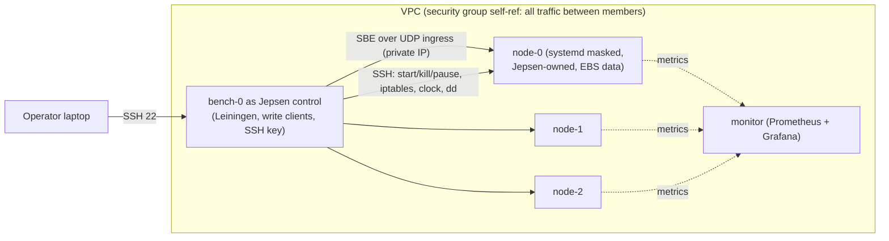
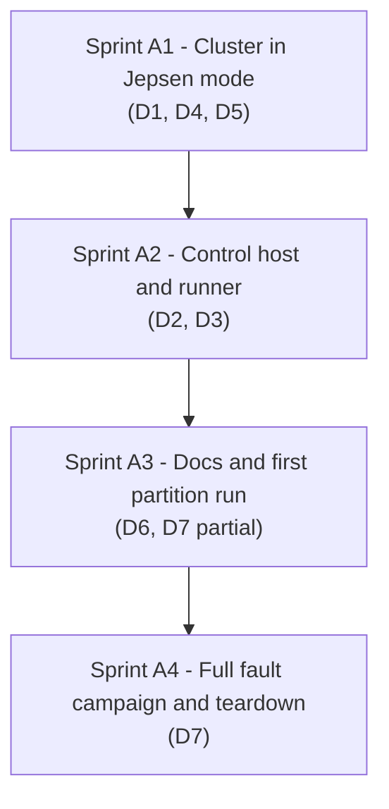

# LEDGERD Jepsen on AWS - Verification Roadmap

Status: Active plan
Date: 2026-11-27

This roadmap plans the addition of a Jepsen verification mode to the existing
AWS deployment under [../deploy/aws](../deploy/aws), alongside the current
benchmark mode. It continues Milestone 3 of [ROADMAP.md](ROADMAP.md): the Jepsen
harness under [../jepsen](../jepsen) is built and compiles clean, and this plan
runs it against a real multi-instance cluster so that partitions, crashes,
pauses, clock skew, and snapshot corruption are exercised on separate kernels
with real UDP.

Sprints are logical increments, not calendar commitments. No time estimates are
attached. This document is a planning artifact; binding design decisions live in
[decisions/](decisions/) as ADRs. It is not an architectural source of truth.

## Why AWS, and how it differs from Docker

The Jepsen harness can run against Docker containers on one host, but containers
share the host kernel clock, so clock-skew faults cannot be injected per node.
AWS instances have separate kernels, so the full fault matrix is available, and
the `ubuntu` cloud user has passwordless sudo, which Jepsen needs for process,
network, clock, and disk control.

| Fault | Docker | AWS |
|-------|:------:|:---:|
| partition (iptables) | yes | yes |
| kill and recover | yes | yes |
| pause (SIGSTOP/SIGCONT) | yes | yes |
| snapshot corruption | yes | yes |
| clock skew | no (shared kernel clock) | yes (separate kernels) |

The intended progression is Docker first (fast, cheap, every fault except clock)
then AWS (adds clock skew and real-scale networking).

## Core design decision: Jepsen owns node lifecycle

The benchmark mode runs each node as a systemd service
([../deploy/aws/ansible/roles/ledgerd-node](../deploy/aws/ansible/roles/ledgerd-node))
under the non-root `ledgerd` user with `Restart=on-failure` and auto-start. That
conflicts with Jepsen, which must start, kill, pause, and restart nodes on its
own schedule: systemd would auto-restart a node Jepsen just killed.

Decision: in Jepsen mode the node systemd unit is stopped and masked, and the
Jepsen DB layer ([../jepsen/src/ledgerd/db.clj](../jepsen/src/ledgerd/db.clj))
owns the node process directly over SSH with sudo. The `db.clj` lifecycle
(upload the launcher tar, write node.properties, start as a daemon, kill,
pause, resume, recover) is unchanged. Benchmark mode and Jepsen mode are
mutually exclusive on the same cluster; a teardown restores systemd.

## Topology



Jepsen runs on the in-VPC control host (the existing `bench-0` instance), not the
operator laptop: the write client sends Aeron UDP to node ingress, which the
security group only permits between members, and SSH to nodes uses private IPs
over the same self-referencing group. The control host needs the cluster SSH key
and Leiningen.

## Task identifiers

- D1 - Node Jepsen-prep role (mask systemd, JDK, curl, build-essential, sudo)
- D2 - Jepsen control role (Leiningen, project and artifact sync, key, nodes
  file, runner script)
- D3 - Playbooks (jepsen.yml, jepsen-run.yml, jepsen-teardown.yml)
- D4 - Parameterize `db.clj` base directory to the EBS data mount
- D5 - Terraform: place the SSH key on the control host (optional dedicated
  control instance)
- D6 - README section and results collection
- D7 - Fault campaign execution and reports

## Milestone overview



---

## Sprint A1 - Cluster in Jepsen mode

Goal: make the cluster nodes controllable by Jepsen rather than by systemd, and
point node recovery at the EBS data volume.

Scope:

- D1 - Add an Ansible role that prepares a node for Jepsen: reuse the `jdk` and
  `common` roles (JDK 21 and the kernel socket-buffer tuning), install `curl`,
  `iptables`, and `build-essential` (the last for the Jepsen clock nemesis),
  ensure the `ubuntu` user has passwordless sudo, and stop and mask
  `ledgerd-node.service` so systemd does not fight Jepsen.
- D4 - Parameterize the base directory in
  [../jepsen/src/ledgerd/db.clj](../jepsen/src/ledgerd/db.clj) (for example via an
  environment variable read in `start-node!`) so a node recovers from the EBS
  mount `/var/lib/ledgerd`, matching the benchmark deployment, rather than a root
  volume path.
- D5 - Terraform change to copy the generated private key onto the control host
  at `/home/ubuntu/.ssh/ledgerd-key.pem` with mode 0600, or provision a dedicated
  `jepsen-control` instance. No security-group change is required; the
  self-referencing group already permits SSH and Aeron UDP between members.

Deliverables: `roles/ledgerd-jepsen-prep`; a `db.clj` base-directory knob; a
Terraform key-placement resource.

Acceptance: after the prep role runs, `systemctl is-enabled ledgerd-node`
reports masked and no node process is running; the control host can
`ssh ubuntu@<node-private-ip>` using the placed key and run `sudo true` without a
password; `db.clj` starts a node whose archive lands under `/var/lib/ledgerd`.

Dependencies: none beyond the existing deployment.

Risk: medium. Masking systemd must be reversible (Sprint A4 teardown).

## Sprint A2 - Control host and runner

Goal: turn the control host into a Jepsen driver and provide a repeatable run
command.

Scope:

- D2 - Add an Ansible role `jepsen-control` that installs Leiningen and JDK 21,
  syncs the `jepsen/` project and the build artifacts
  (`write-client.jar`, `protocol.jar`, `launcher.tar`) to the control host,
  renders a `nodes.txt` from the node private IPs in node-id order, places the
  SSH key, and installs a `/usr/local/bin/ledgerd-jepsen` wrapper that runs
  `lein run test` with the right nodes, user, and sudo settings.
- D3 - Add `playbooks/jepsen.yml` that applies `ledgerd-jepsen-prep` to the nodes
  and `jepsen-control` to the control host, mirroring `deploy.yml`.

Deliverables: `roles/jepsen-control`; `playbooks/jepsen.yml`; the
`ledgerd-jepsen` runner script.

Acceptance: `ansible-playbook playbooks/jepsen.yml` completes; on the control
host `ledgerd-jepsen --nemesis none --time-limit 60` runs a no-fault test to
completion and the conservation checker reports valid.

Dependencies: Sprint A1.

Risk: medium. First end-to-end wiring of the control host, SSH, and Aeron UDP.

## Sprint A3 - Docs and first partition run

Goal: document the Jepsen verify mode next to the benchmark mode and prove a
partition run end to end.

Scope:

- D3 - Add `playbooks/jepsen-run.yml` (parallel to `bench.yml`) that runs
  `ledgerd-jepsen` with `jepsen_nemesis`, `jepsen_time_limit`,
  `jepsen_concurrency`, and `jepsen_nemesis_interval` variables, as a long-running
  async task, and fetches the `store/` output back to the operator.
- D6 - Add a Jepsen verify section to
  [../deploy/aws/README.md](../deploy/aws/README.md) describing the workflow
  (build artifacts, terraform apply, `jepsen.yml`, `jepsen-run.yml`, collect
  results), the mode exclusivity with benchmarking, and the recommended
  `dedupWindow` sizing (well above the in-flight count so a retry after a long
  partition does not re-apply outside the window and trip a false positive).
- D7 (partial) - Run `--nemesis partition` and confirm the checker and Grafana.

Deliverables: `playbooks/jepsen-run.yml`; README section; a first partition
report under `store/`.

Acceptance: `ansible-playbook playbooks/jepsen-run.yml -e jepsen_nemesis=partition`
produces a `store/` report with conservation `:valid? true`; Grafana shows leader
elections coinciding with the induced partitions.

Dependencies: Sprint A2.

Risk: medium.

## Sprint A4 - Full fault campaign and teardown

Goal: exercise the remaining faults and make the mode switch clean.

Scope:

- D7 - Run `--nemesis kill`, `pause`, `clock`, and `corrupt`, collecting a report
  per fault. Clock skew is the AWS-only fault; corruption targets the newest
  archive recording and must be rejected by the snapshot checksum on recovery.
- D3 - Add `playbooks/jepsen-teardown.yml` that unmasks and restarts the node
  systemd service, restoring benchmark mode, and optionally wipes
  `/var/lib/ledgerd` for a clean next run.
- D6 - Record in the README which faults are AWS-only (clock) and the expected
  outcomes (checker valid for partition/kill/pause; checksum rejection for
  corrupt).

Deliverables: reports for kill, pause, clock, corrupt; `jepsen-teardown.yml`.

Acceptance: each fault run yields a valid conservation result (or, for corrupt, a
node that refuses to load the corrupted snapshot rather than serving wrong state);
after teardown, `systemctl is-enabled ledgerd-node` is enabled and the cluster
serves the benchmark again.

Dependencies: Sprint A3.

Risk: medium to high. Clock and disk faults interact with Aeron liveness and
recovery.

---

## Prerequisites

- An AWS account and credentials for `terraform apply`; the run incurs cost
  (three c6i.xlarge nodes plus a control host and a monitor), so
  `terraform destroy` after the campaign.
- Artifacts built from the repository root:

  ```bash
  ./gradlew :launcher:distTar :write-client:jar :protocol:jar
  ```

- The operator SSH key at `deploy/aws/.ssh/ledgerd-key.pem` (Terraform generates
  it) and, after Sprint A1, a copy on the control host for node-to-node SSH.

## Workflow summary

```bash
# 1. Build artifacts
./gradlew :launcher:distTar :write-client:jar :protocol:jar

# 2. Provision
cd deploy/aws/terraform && terraform apply

# 3. Put the cluster in Jepsen mode (mask systemd, install Leiningen, push jars)
cd ../ansible && ansible-playbook -i inventory/hosts.yml playbooks/jepsen.yml

# 4. Run a fault campaign (repeat per nemesis)
ansible-playbook -i inventory/hosts.yml playbooks/jepsen-run.yml \
  -e jepsen_nemesis=partition -e jepsen_time_limit=300

# 5. Restore benchmark mode when done
ansible-playbook -i inventory/hosts.yml playbooks/jepsen-teardown.yml

# 6. Tear down infrastructure
cd ../terraform && terraform destroy
```

## Out of scope

- Changes to the Jepsen harness logic ([../jepsen](../jepsen)); only the
  base-directory knob (D4) is touched.
- The bank transfer-conservation workload, which needs a linearizable read path
  not yet wired into the harness (noted in the Milestone 3 J2 work).
- A self-hosted GitHub Actions runner to drive the AWS campaign from CI; the
  nightly workflow ([../.github/workflows/jepsen-nightly.yml](../.github/workflows/jepsen-nightly.yml))
  still only builds and compiles the harness.
