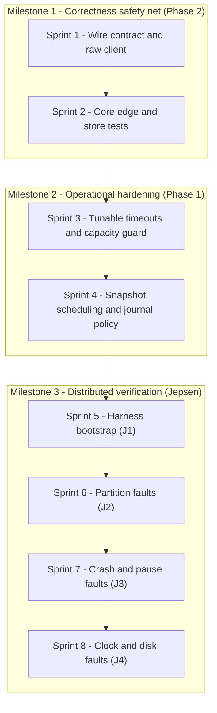
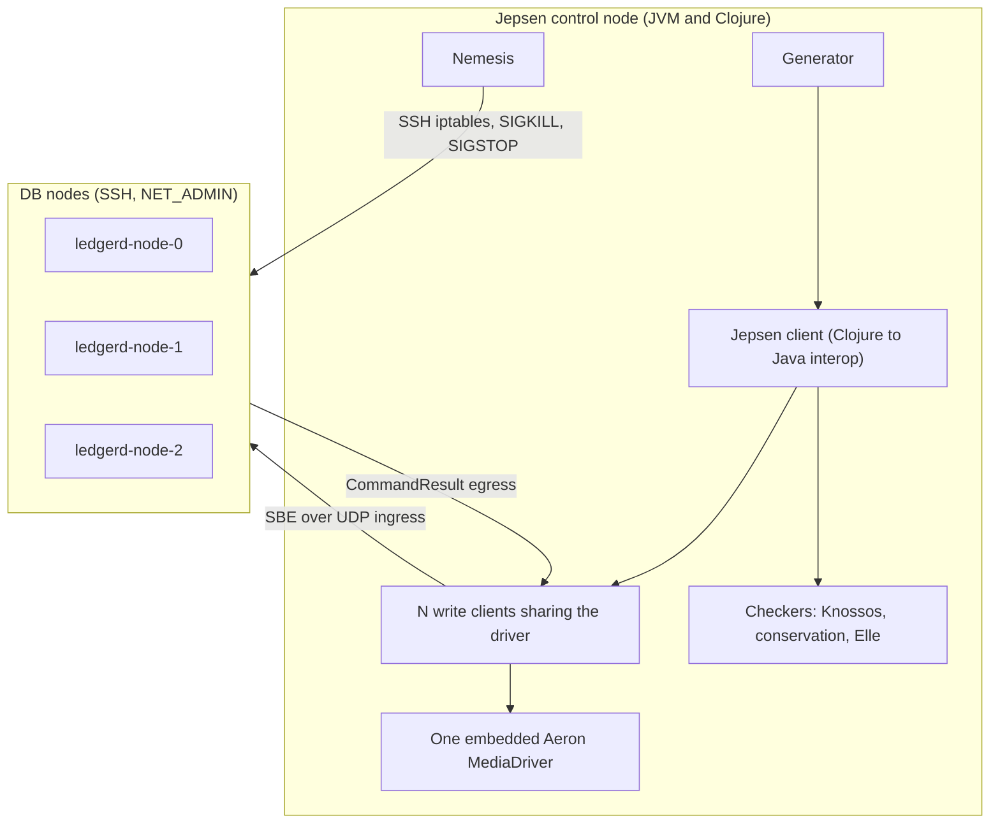
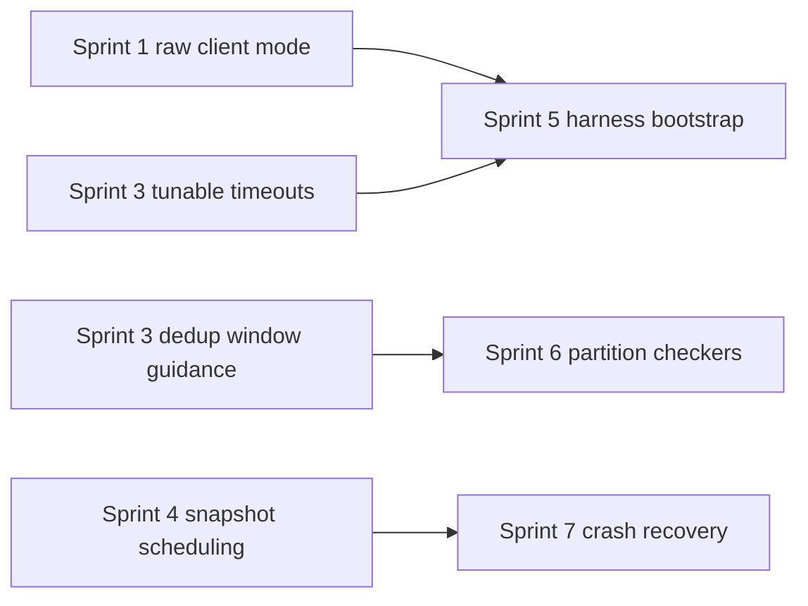

# LEDGERD Improvement Roadmap

Status: Active plan
Date: 2026-11-26

This roadmap turns the project audit into an executable plan, organized by
milestone and sprint. It covers two improvement phases (test safety net and
operational hardening) followed by a distributed-systems verification track
built on Jepsen with fault injection.

Sprints are logical increments, not calendar commitments. No time estimates are
attached. Every code change in these sprints MUST pass the full local CI
sequence before commit: `spotlessApply`, `checkstyleMain checkstyleTest`,
`compileJava` (with `-Werror`), `test integrationTest`, and
`:core:jmh -PquickBench` with no regression greater than 10 percent. All changes
remain local (no remote push).

This document is a planning artifact. It is not an architectural source of
truth. Binding design decisions live in [decisions/](decisions/) as ADRs. Where
a sprint requires a decision (for example the event-journal backpressure
policy), it produces a new ADR.

## Task identifiers

The audit assigned stable identifiers that this roadmap reuses:

- H1 - Event journal backpressure policy (ADR follow-up to 0011)
- H2 - Snapshot scheduling strategy and runbook
- H3 - Capacity sizing worked examples and guard
- M1 - Protocol SBE round-trip and backward-compatibility tests
- M2 - Launcher bootstrap smoke test
- M3 - AllowanceStore and BalanceStore isolated unit tests
- M4 - Core edge property tests (dedup, undo stack, journal overflow)
- M6 - Tunable Aeron election and heartbeat timeouts

Jepsen tasks are identified as J1 through J4.

## Milestone overview

Milestone 1 ships first because it is pure logic, needs no network, and forms
the safety net that must exist before fault injection is introduced. Milestone 2
delivers the operational knobs that the Jepsen track depends on (notably tunable
timeouts). Milestone 3 builds the Jepsen harness and exercises it against real
network faults.

---

## Milestone 1 - Correctness safety net (Phase 2)

Goal: close the test gaps that let a wire-format or state-machine regression
reach a release unnoticed, and seed the client prerequisite that the Jepsen
harness needs.

### Sprint 1 - Wire contract and raw client mode

Goal: validate the SBE wire contract in isolation and add a non-retrying client
mode so that later fault tests can observe raw indeterminate outcomes.

Scope:

- M1 - Create `protocol/src/test`. Round-trip encode then decode for every
  message: `CommandEnvelope`, `CommandResult`, `TransferBatch`,
  `TransferBatchResult`, snapshot records, and all query request and response
  messages. Assert byte length, field values, and little-endian layout.
- M1 - Backward-compatibility: decode a message written at an older schema
  version and assert optional fields resolve to their documented defaults
  (for example `assetId` defaults to 0).
- Jepsen prerequisite - Add a raw single-shot submission mode to the
  write-client that does not auto-retry and surfaces a timeout as an
  indeterminate result. Keep the existing idempotent-retry mode intact. This
  lets a linearizability checker see `:info` on timeout rather than a hidden
  internal retry.

Deliverables: new protocol test source set; a raw client entry point in
[write-client](../write-client/README.md).

Acceptance: protocol round-trip tests pass for all templates; a decode of a
simulated older-schema buffer yields correct defaults; raw client returns an
explicit indeterminate status on timeout without resending.

Dependencies: none.

Risk: low. Pure logic, no network.

### Sprint 2 - Core edge and store tests

Goal: cover the state-machine edges that in-process happy-path tests miss.

Scope:

- M4 - Property test (jqwik): dedup eviction after sequence wraparound treating
  the sequence as unsigned 64-bit.
- M4 - Property test: `DedupTable.forEachSorted` and `forEachSortedBatch`
  produce a stable, deterministic order across repeated snapshots.
- M4 - Boundary test: transfer-batch undo stack is exact at `maxBatchSize` legs
  where every leg touches distinct accounts; assert no write past `undoTop`.
- M4 - Overflow and drop test: event journal ring full results in a silent drop
  plus a counter increment and no hot-path block.
- M3 - Isolated unit tests for
  [AllowanceStore](../core/src/main/java/io/justrade/ledgerd/collections/AllowanceStore.java):
  triple-nesting, delegation revocation, allowance cap at `Long.MAX_VALUE`.
- M3 - Isolated unit tests for
  [BalanceStore](../core/src/main/java/io/justrade/ledgerd/collections/BalanceStore.java)
  single-asset cache hit path.
- M2 - Launcher bootstrap smoke test: start an in-process media driver, archive,
  consensus module, and clustered-service container, then submit one command and
  observe a result.

Deliverables: new tests under
[tests/src/test](../tests/src/test) for core, collections, pipeline, and
launcher.

Acceptance: all new tests pass under `test` and `integrationTest`; JaCoCo shows
AllowanceStore and BalanceStore covered directly; launcher smoke test green.

Dependencies: none. Can run in parallel with Sprint 1.

Risk: low.

---

## Milestone 2 - Operational hardening (Phase 1)

Goal: deliver the operational controls and decisions that production deployment
and the Jepsen track both require.

### Sprint 3 - Tunable timeouts and capacity guard

Goal: make failover timing configurable (a hard Jepsen prerequisite) and prevent
a known capacity misconfiguration.

Scope:

- M6 - Expose tunable Aeron election and heartbeat timeouts through launcher
  configuration. Document the parameters, defaults, and safe bounds in
  [OPERATIONS.md](OPERATIONS.md). Without this, a Jepsen nemesis cycle cannot be
  made shorter than the default election window, which is observed at roughly 15
  to 20 seconds.
- H3 - Add validation that warns when `batchDedupWindow` is set greater than or
  equal to `maxBatchSize`, a pattern that out-of-memory errors a small heap.
  Place the guard in
  [CoreConfig](../core/src/main/java/io/justrade/ledgerd/config/CoreConfig.java).
- H3 - Add three worked sizing examples (small, medium, large) to
  [CAPACITY-PLANNING.md](CAPACITY-PLANNING.md).

Deliverables: new config keys; validation guard; operations and capacity docs
updated.

Acceptance: election and heartbeat timeouts can be lowered via config and a
multi-node integration test confirms faster failover; the capacity guard rejects
or warns on the dangerous ratio with a unit test; capacity docs contain concrete
numbers.

Dependencies: none.

Risk: medium. Lowering Aeron timeouts can increase false-positive elections;
bound the configuration and test for stability.

### Sprint 4 - Snapshot scheduling and journal backpressure policy

Goal: control log growth and read-replica cold-start time, and resolve the open
event-journal durability question.

Scope:

- H2 - Add snapshot scheduling driven by `snapshotIntervalCommands` or
  `snapshotIntervalSeconds`. The trigger MUST use the cluster timer service, not
  a wall-clock read on the hot thread, to preserve determinism. Add a runbook
  section to [OPERATIONS.md](OPERATIONS.md).
- H1 - Write a new ADR (next number after
  [0013](decisions/0013-graph-query-engine.md)) that chooses the event-journal
  overflow policy: block and reject ingress for a lossless audit journal, versus
  drop and alert for a best-effort journal. Add a `journalOverflowPolicy` config
  key and implement the chosen behavior in
  [EventJournalRing](../core/src/main/java/io/justrade/ledgerd/pipeline/EventJournalRing.java)
  and the event offer path in
  [BalanceService](../core/src/main/java/io/justrade/ledgerd/core/BalanceService.java).

Deliverables: snapshot scheduling in the launcher; a new ADR; a
`journalOverflowPolicy` implementation and tests.

Acceptance: an integration test shows a snapshot is taken after N committed
commands and a read replica cold-starts from it; the chosen overflow policy is
exercised by a deterministic test (either ingress is rejected under BLOCK, or the
event is dropped and the counter increments under DROP) with no hot-path block in
the drop case.

Dependencies: none, but benefits from Sprint 3 timeout knobs during testing.

Risk: medium. The BLOCK policy changes ingress semantics and must be opt-in.

---

## Milestone 3 - Distributed verification with Jepsen

Goal: verify the linearizable write, exactly-once, and supply-conservation
claims under real network faults, not just in-process leader kills.

### Consistency model mapping

LEDGERD provides linearizable writes through Raft consensus, exactly-once
application through a bounded per-client dedup window keyed by
`(clientId, clientSeq)`, and a conserved total-supply invariant. Reads served by
the read replica are eventually consistent and are therefore not a valid
linearization point. The harness uses the `resultBalance` returned in
`CommandResult` as the linearizable observation, because that value reflects the
post-apply state in log order on the leader. Supply conservation is checked at
quiescence after the read replica has caught up.

### Harness architecture

Key decisions:

- The Jepsen client uses Clojure-to-Java interop against the existing
  write-client and protocol jars. It does not reimplement SBE or the Aeron
  cluster client. One embedded media driver is shared by N write clients in the
  control JVM.
- DB nodes reuse the existing
  [ClusterLauncher](../launcher/README.md) with a properties file, as the Docker
  topology already does. Nodes run on hosts that grant SSH and the `NET_ADMIN`
  capability so the nemesis can manipulate iptables.

### Aeron-specific challenges and mitigations

- Partitions act on UDP. The nemesis must drop traffic in both directions on the
  consensus, log, and catchup ports between members. Verify leader step-down and
  the absence of split-brain.
- The default election window (roughly 15 to 20 seconds) must be shortened via
  the Sprint 3 timeout configuration so a nemesis cycle can be longer than the
  election window yet still make progress.
- The dedup window is bounded. A retry after a long partition that exceeds the
  window re-applies by design. Configure `dedupWindow` much larger than the
  in-flight count during tests and make the checker aware of the window size to
  avoid false positives.
- The media driver maps term buffers into shared memory. A killed node restarts
  with driver directory deletion enabled and recovers from the archive and
  snapshot.
- Clock skew does not affect the clockless deterministic core; it only affects
  Aeron liveness and elections. It is still tested to confirm no committed write
  is lost when clocks jump.
- Jepsen runs require root for iptables and are long-running. They run in a
  dedicated nightly or manual workflow, not in the standard CI gate.

### Sprint 5 - Harness bootstrap (J1)

Goal: stand up a runnable Jepsen harness with no faults and confirm the history
and a trivial checker work end to end.

Scope:

- Create a `jepsen/` module with a Leiningen project and Clojure sources.
- Implement node setup and teardown: install the launcher distribution, write a
  per-node properties file, start and stop the service over SSH, and wait for
  `/healthz` readiness.
- Implement the Jepsen client via Java interop: connect, submit CREDIT, DEBIT,
  and TRANSFER, and record `resultBalance` and status.
- Implement a counter workload generator and a trivial checker.

Deliverables: `jepsen/` module; a smoke test that runs with no nemesis and
produces a valid history.

Acceptance: a no-nemesis run completes, the history is well-formed, and the
trivial checker reports valid.

Dependencies: Sprint 1 raw client mode; Sprint 3 timeout configuration.

Risk: medium. First end-to-end wiring of Clojure, Aeron, and SSH.

### Sprint 6 - Partition faults (J2)

Goal: exercise network partitions and add the real consistency checkers.

Scope:

- Nemeses: `partition-random-halves`, `isolate-leader`, and
  `partition-majorities-ring` targeting the Raft ports.
- Checkers: a Knossos counter or compare-and-set model using `resultBalance`,
  plus a custom conservation checker asserting the sum of balances equals total
  supply at quiescence.
- Bank workload: random transfers across N accounts, including linked
  `TransferBatch` chains, asserting value conservation.

Deliverables: partition nemeses, Knossos and conservation checkers, bank
workload.

Acceptance: partition runs show no lost committed writes, no split-brain, and no
supply violation; the exactly-once property holds across induced leader changes.

Dependencies: Sprint 5.

Risk: medium.

### Sprint 7 - Crash and pause faults (J3)

Goal: test crash recovery and simulated long pauses.

Scope:

- Nemeses: SIGKILL followed by restart and recovery from the archive and
  snapshot; SIGSTOP and SIGCONT to simulate a garbage-collection pause.
- Idempotency storm workload: resubmit the same `(clientId, clientSeq)` under a
  leader kill and assert exactly-once application, elevating the existing
  in-process
  [RetryStormFailoverTest](../tests/src/test/java/io/justrade/ledgerd/cluster/RetryStormFailoverTest.java)
  to real network conditions.

Deliverables: crash and pause nemeses; idempotency storm workload.

Acceptance: a killed node recovers deterministically and rejoins; a paused node
does not cause data loss or a split-brain; exactly-once holds under storms.

Dependencies: Sprint 6.

Risk: medium to high. Recovery and pause timing interact with Aeron liveness.

### Sprint 8 - Clock and disk faults (J4) and nightly workflow

Goal: cover clock skew and archive corruption, and automate the suite.

Scope:

- Nemeses: clock skew to confirm election stability and no committed-write loss;
  snapshot or archive corruption targeting the checksum verification in
  [SnapshotManager](../core/src/main/java/io/justrade/ledgerd/persistence/SnapshotManager.java).
- Add a nightly or manual workflow that provisions nodes, runs the Jepsen suite,
  and archives histories and checker reports.

Deliverables: clock and disk nemeses; a dedicated distributed-verification
workflow separate from the standard CI gate.

Acceptance: clock-skew runs preserve all committed writes; corruption is detected
by checksum rather than applied silently; the nightly workflow runs the full
suite and publishes artifacts.

Dependencies: Sprint 7.

Risk: medium.

---

## Cross-milestone dependencies

## Out of scope for this roadmap

- Graph query engine (ADR [0013](decisions/0013-graph-query-engine.md), proposed,
  not implemented).
- Sharding and cross-shard atomicity (ADR
  [0003](decisions/0003-cross-shard-deferred.md), deferred to a later phase,
  pending a 2PC-versus-Saga decision).
